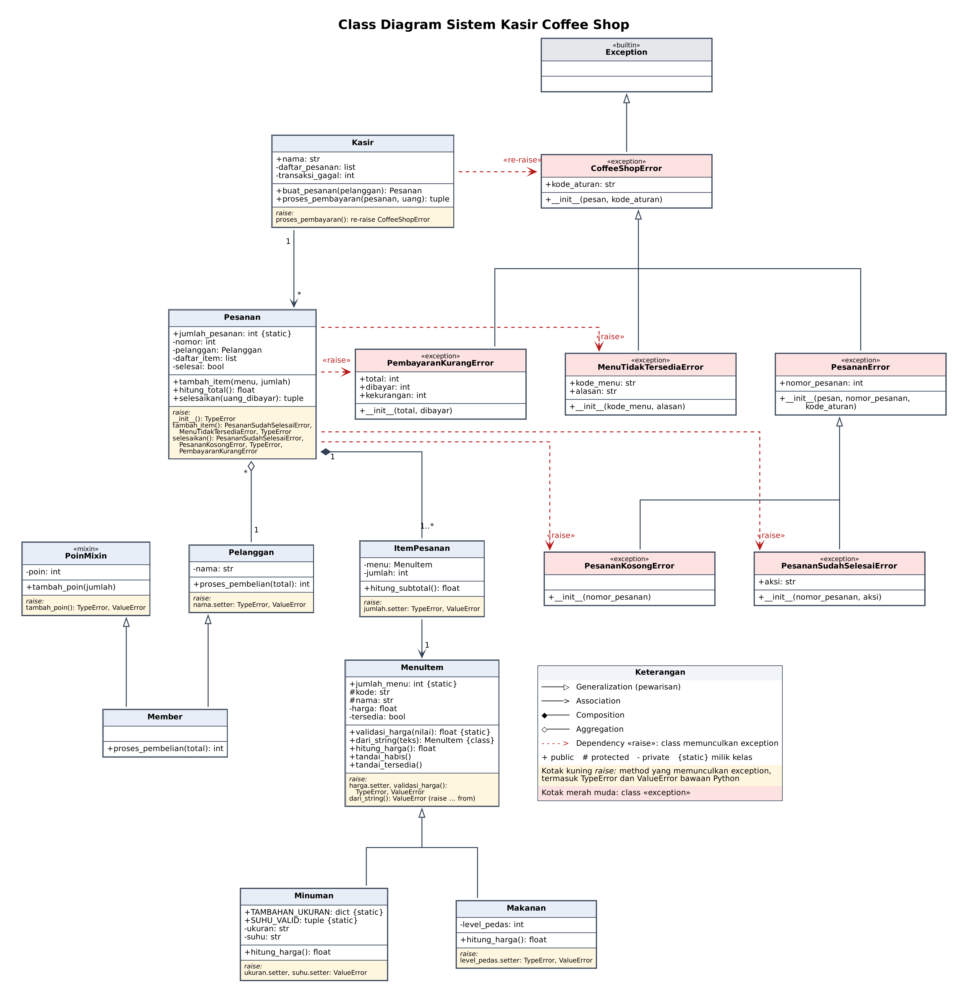

# Tugas-P9-PBO
## KELOMPOK 2

## Anggota kelompok
1. I Gede Eka Parjana Putra 2501010004
2. I Gde Bintang Askha Abimanyu 2501010005
3. Dewa Ade Deni Krisnanta 2501010031

## DESKRIPSI SISTEM

Sistem ini adalah program kasir sederhana untuk coffee shop yang kami rancang di UTS. Coffee shop menjual dua jenis menu, yaitu minuman dan makanan. Harga minuman bisa bertambah tergantung ukuran (S, M, L) dan suhu (panas atau dingin), sedangkan harga makanan bertambah kalau level pedasnya 4 ke atas.

Pelanggan dibagi menjadi dua, yaitu pelanggan biasa dan member. Member mendapat 1 poin untuk setiap belanja Rp10.000. Kasir membuat pesanan untuk seorang pelanggan, memasukkan item menu beserta jumlahnya, lalu memproses pembayaran.

Repository ini melanjutkan proyek UTS tersebut dengan menambahkan exception handling. Commit pertama berisi kode UTS yang kami ketik ulang tanpa perubahan, dan penambahan exception handling kami lakukan di commit-commit setelahnya. Jadi perbedaan sebelum dan sesudahnya bisa dilihat langsung di riwayat git.

## TABEL ATURAN BISNIS

| Kode | Aturan bisnis | Dicek di | Exception |
|------|---------------|----------|-----------|
| AB-01 | Harga menu harus berupa angka dan lebih dari 0 | `MenuItem.harga` (setter), `validasi_harga()` | `TypeError`, `ValueError` |
| AB-02 | Ukuran minuman hanya boleh S, M, atau L, dan suhu hanya boleh panas atau dingin | `Minuman.ukuran`, `Minuman.suhu` (setter) | `ValueError` |
| AB-03 | Level pedas minimal 0 dan maksimal 5 | `Makanan.level_pedas` (setter) | `TypeError`, `ValueError` |
| AB-04 | Nama pelanggan tidak boleh kosong | `Pelanggan.nama` (setter) | `TypeError`, `ValueError` |
| AB-05 | Jumlah tiap item pesanan minimal 1 dan maksimal 20 | `ItemPesanan.jumlah` (setter) | `TypeError`, `ValueError` |
| AB-06 | Menu hanya bisa dipesan jika ada di daftar menu dan sedang tersedia | `Pesanan.tambah_item()`, `cari_menu()` | `MenuTidakTersediaError` |
| AB-07 | Pesanan yang sudah dibayar tidak boleh ditambah item atau dibayar lagi | `Pesanan.tambah_item()`, `Pesanan.selesaikan()` | `PesananSudahSelesaiError` |
| AB-08 | Pesanan yang belum berisi item tidak boleh dibayar | `Pesanan.selesaikan()` | `PesananKosongError` |
| AB-09 | Uang yang dibayarkan minimal sebesar total pesanan | `Pesanan.selesaikan()` | `PembayaranKurangError` |
| AB-10 | Poin member tidak boleh ditambah dengan nilai negatif | `PoinMixin.tambah_poin()` | `TypeError`, `ValueError` |


## CLASS DIAGRAM REVISI



**Notasi yang dipakai:**

- `+` public, `#` protected, `-` private, dan `{static}` untuk atribut atau method milik kelas.
- Kotak kuning bertuliskan **raise:** di bagian bawah kelas mencatat method mana yang memunculkan exception apa.

| Garis | Arti |
|-------|------|
| Garis dengan segitiga kosong | Generalization (pewarisan) |
| Garis dengan panah terbuka | Association |
| Belah ketupat hitam | Composition |
| Belah ketupat putih | Aggregation |

Kalau gambar di atas terlalu kecil, kedua bagiannya juga tersedia dalam ukuran lebih besar:


## DAFTAR CUSTOM EXCEPTION
Semua exception buatan kami berinduk ke `CoffeeShopError`. Dengan begitu, kalau ingin menangkap semua error milik aplikasi sekaligus, cukup pakai `except CoffeeShopError`.

| Nama | Class induk | Atribut konteks | Kapan dimunculkan | Method yang memunculkan | Cara program menanganinya |
|------|-------------|-----------------|-------------------|-------------------------|---------------------------|
| `CoffeeShopError` | `Exception` | `kode_aturan` | Tidak dimunculkan langsung. Menjadi induk semua exception aplikasi | - | Ditangkap di `jalankan_skenario()` sebagai penangkap umum untuk error aplikasi. `Kasir.proses_pembayaran()` juga menangkapnya untuk mencatat pembayaran gagal, lalu meneruskannya lagi (re-raise) |
| `MenuTidakTersediaError` | `CoffeeShopError` | `kode_menu`, `alasan` | Kode menu tidak ada di daftar menu, atau menu sedang habis | `cari_menu()` (dari `KeyError` lewat `raise ... from`), `Pesanan.tambah_item()` | Ditangkap oleh `except CoffeeShopError`. Program menampilkan pesan, dan kalau ada, penyebab aslinya (`KeyError`) dari `e.__cause__` |
| `PesananError` | `CoffeeShopError` | `nomor_pesanan` | Tidak dimunculkan langsung. Menjadi induk error yang berkaitan dengan status pesanan | - | Ditangkap oleh `except PesananError`, sehingga kedua turunannya cukup ditangani di satu blok |
| `PesananKosongError` | `PesananError` | `nomor_pesanan` (warisan) | Pesanan dibayar padahal belum berisi item | `Pesanan.selesaikan()` | `Kasir` mencatat pembayaran gagal lalu re-raise. Program utama menangkapnya dengan `except PesananError` dan menampilkan pesan |
| `PesananSudahSelesaiError` | `PesananError` | `nomor_pesanan` (warisan), `aksi` | Pesanan yang sudah lunas ditambah item atau dibayar lagi | `Pesanan.tambah_item()`, `Pesanan.selesaikan()` | Sama seperti `PesananKosongError`, ditangkap oleh `except PesananError` |
| `PembayaranKurangError` | `CoffeeShopError` | `total`, `dibayar`, `kekurangan` | Uang yang dibayarkan lebih kecil dari total pesanan | `Pesanan.selesaikan()` | `Kasir` mencatat pembayaran gagal lalu re-raise. Program utama menangkapnya di blok `except` paling atas, lalu menampilkan pesan beserta nominal yang masih kurang dari atribut `kekurangan` |

Semua exception di atas juga mewarisi atribut `kode_aturan` dari `CoffeeShopError`. Atribut ini menunjuk ke kode aturan di tabel bagian 3, jadi di output program kelihatan aturan mana yang dilanggar, misalnya `[DITOLAK AB-09]`.

`PesananError` sengaja kami buat sebagai kelompok tersendiri karena `PesananKosongError` dan `PesananSudahSelesaiError` sama-sama berkaitan dengan status pesanan dan sama-sama butuh informasi nomor pesanan.

## Cara menjalankan dan contoh output

Program menjalankan satu skenario yang berhasil dan lima skenario yang sengaja dibuat gagal:

| Skenario | Hasil | Exception yang ditangkap |
|----------|-------|--------------------------|
| 1. Pesanan normal (Budi, member) | Berhasil | Tidak ada, masuk ke blok `else` |
| 2. Uang kurang | Gagal | `PembayaranKurangError` |
| 3. Kode menu salah | Gagal | `MenuTidakTersediaError` (berasal dari `KeyError`) |
| 4. Menu sedang habis | Gagal | `MenuTidakTersediaError` |
| 5. Memesan 25 item sekaligus | Gagal | `ValueError` |
| 6. Pesanan dibayar dua kali | Gagal | `PesananSudahSelesaiError` |

Output hasil menjalankan program:
| Skenario | Hasil | Exception yang ditangkap |
|----------|-------|--------------------------|
| 1. Pesanan normal (Budi, member) | Berhasil | Tidak ada, masuk ke blok `else` |
| 2. Uang kurang | Gagal | `PembayaranKurangError` |
| 3. Kode menu salah | Gagal | `MenuTidakTersediaError` (berasal dari `KeyError`) |
| 4. Menu sedang habis | Gagal | `MenuTidakTersediaError` |
| 5. Memesan 25 item sekaligus | Gagal | `ValueError` |
| 6. Pesanan dibayar dua kali | Gagal | `PesananSudahSelesaiError` |

Output hasil menjalankan program:


| Skenario | Hasil | Exception yang ditangkap |
|----------|-------|--------------------------|
| 1. Pesanan normal (Budi, member) | Berhasil | Tidak ada, masuk ke blok `else` |
| 2. Uang kurang | Gagal | `PembayaranKurangError` |
| 3. Kode menu salah | Gagal | `MenuTidakTersediaError` (berasal dari `KeyError`) |
| 4. Menu sedang habis | Gagal | `MenuTidakTersediaError` |
| 5. Memesan 25 item sekaligus | Gagal | `ValueError` |
| 6. Pesanan dibayar dua kali | Gagal | `PesananSudahSelesaiError` |

Output hasil menjalankan program:
```
=== Skenario 1: pesanan normal ===
Pesanan #1 - Budi [LUNAS]
  2 x Latte = Rp60,000
  1 x Mie Pedas = Rp20,000
  TOTAL = Rp80,000
[BERHASIL] Kembalian Rp20,000, poin didapat 8. Member Budi (poin: 8)
--- Kasir Sari: 1 pesanan, 0 pembayaran gagal ---

=== Skenario 2: uang kurang ===
[DITOLAK AB-09] Uang Rp25,000 kurang dari total Rp30,000
  Minta pelanggan menambah Rp5,000
--- Kasir Sari: 2 pesanan, 1 pembayaran gagal ---

=== Skenario 3: kode menu salah ===
[DITOLAK AB-06] Menu 'MN99' tidak ada di daftar menu
  Penyebab asli: KeyError: 'MN99'
--- Kasir Sari: 3 pesanan, 1 pembayaran gagal ---

=== Skenario 4: menu habis ===
[DITOLAK AB-06] Menu 'MN02' sedang habis
--- Kasir Sari: 4 pesanan, 1 pembayaran gagal ---

=== Skenario 5: jumlah melebihi batas ===
[INPUT TIDAK VALID] ValueError: Jumlah per item harus 1 sampai 20, diterima: 25
--- Kasir Sari: 5 pesanan, 1 pembayaran gagal ---

=== Skenario 6: dibayar dua kali ===
[DITOLAK AB-07] Pesanan #6 sudah selesai, tidak bisa dibayar lagi
--- Kasir Sari: 6 pesanan, 2 pembayaran gagal ---

=== Info tambahan ===
True
False
['Member', 'Pelanggan', 'PoinMixin', 'object']
['PesananKosongError', 'PesananError', 'CoffeeShopError', 'Exception', 'BaseException', 'object']
```

## PEMBAGIAN PERAN

| No | Nama | Peran |
|----|------|-------|
| 1 | [Eka] | [revisi diagram uml, ] |
| 2 | [Bintang] | [membuat kode exception, ] |
| 3 | [Deni] | [sdgsg, membuat kode baru main progam yaitu menambahkan] |
